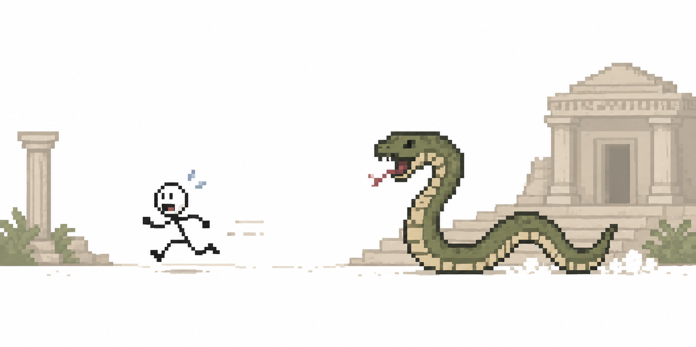
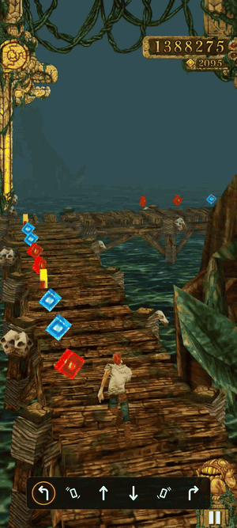

<p align="center">
  
</p>

<h1 align="center">🏃 TempleRun-RL: Reinforcement Learning on the Real Game, on a Real Phone</h1>

<p align="center">
  <b>A PPO agent trained in a headless simulator, deployed on an unrooted Android phone,<br>
  running past 16 km in the real <i>Temple Run</i>, with no screen scraping and no synthetic touches.</b>
</p>

<p align="center">
  <a href="https://www.matscharffe.com/projects/temple-run-rl"></a>
  
  
  <a href="LICENSE"></a>
</p>

<p align="center">
  
  <br>
  <i>The agent crossing the <b>10,000 m</b> mark at top speed, mid-way through a 16,782 m run.<br>
  The bar at the bottom lights up each command the policy sends: turn ↰, tilt, jump ↑, slide ↓, turn ↱.</i>
</p>


---

## ✨ Overview

*Temple Run* is a closed, arm64-only Unity game. This project plays it with a neural network:

- 🔌 **No root, no pixels.** A [Frida](https://frida.re) gadget injected into the APK reads the game state
  directly from memory (player, track cells, obstacles, turns) and executes actions by calling the game's
  own methods. Both go over TCP at 30 Hz; the policy acts at 10 Hz.
- 🧪 **Sim-to-real.** Training happens in a headless simulator built from the game's reverse-engineered
  internals (track generation, obstacles, runner physics) and **calibrated on measurements from the real
  phone** (jump arcs, turn windows, crevasse ledges, input latency). A fast C++ version of the simulator
  trains 10M steps in about 6 minutes.

```
  Android phone (arm64, no root)                Host (this repo)
 ┌───────────────────────────────┐            ┌──────────────────────────────┐
 │ Temple Run + Frida gadget     │  tcp:9999  │ StateClient ─► TempleRunEnv  │
 │  • reads CharacterPlayer/...  │ ─────────► │  (gymnasium.Env)  ─► PPO     │
 │  • calls Jump/Slide/Turn/...  │ ◄───────── │ ActionClient ◄─ env.step()   │
 └───────────────────────────────┘  tcp:9998  └──────────────────────────────┘
        adb forward maps the phone's 9999 / 9998 / 27042 to 127.0.0.1
```

## 🏆 Pretrained Policy

| Policy | Device runs | Median | Best |
|---|:---:|:---:|:---:|
| [`templerun_runner_v1.zip`](models/MODELS.md) | 14 | 4,736 m | **16,782 m** |

## 🚀 Quick Start

### 1. Install

```bash
git clone https://github.com/matthieucs/TempleRun-RL.git
cd TempleRun-RL
pip install -r requirements.txt
pip install -e .
```

You also need `adb`, a **non-rooted arm64 Android phone** with USB debugging enabled, and your own copy of
Temple Run v1.39.0, patched once with the Frida gadget ([`docs/SETUP.md`](docs/SETUP.md)).

> [!IMPORTANT]
> **The game is not included.** This repo ships only our own code. Supply a legally obtained APK and build
> the instrumented copy yourself with `tools/build_gadget_apk.py`.

### 2. Bring the phone up

Open the game, then forward the ports and inject the agent. **Leave this process running**: if it exits,
the in-game agent unloads.

```bash
python scripts/device/setup_device.py --serial <your-serial>
```

### 3. Watch the policy play

```bash
python scripts/device/capture_calib.py models/templerun_runner_v1.zip --episodes 5 --turn-cooldown 0 --max-steps 8000
```

### 4. Record a video with the action overlay

```bash
python scripts/device/record_overlay.py models/templerun_runner_v1.zip \
    --serial <your-serial> --episodes 1 --out-dir videos/ --max-steps 8000
```

This mirrors and records the phone with [scrcpy](https://github.com/Genymobile/scrcpy), logs every
action, then draws the command bar onto the video (`ffmpeg` required).

## 🔬 Training

Training runs in the simulator, not on the phone. The phone is only used to **measure** how the real game
behaves and to evaluate finished policies.

> [!NOTE]
> The C++ simulator (`cpp_sim/`) was developed and tested on **Windows** only. It has not been
> validated on Linux or macOS.

```bash
# build the C++ simulator (once, and after any change to it)
sh cpp_sim/build.sh

# fine-tune the shipped policy for 10M steps
bash configs/train.sh

# evaluate the result on the phone
python scripts/device/capture_calib.py runs/templerun_runner_next_final.zip --episodes 8 --turn-cooldown 0 \
    --out captures/next_device.jsonl
```

<details>
<summary><b>What the main training settings do</b></summary>

The full command is in [`configs/train.sh`](configs/train.sh); the simulated world is
[`configs/sim_world.json`](configs/sim_world.json).

| Flag | Why |
|---|---|
| `--backend cpp` | about 7× faster than the Python simulator (26–28k vs 3.7k steps/s) |
| `--num-envs 256 --n-steps 16` | keep `num_envs × n_steps = 4096`; widening `num_envs` alone is faster but much worse |
| `--landing-hazard-penalty 0.30` | penalizes a jump whose arc lands on a hazard |
| `--stepdown-jump-penalty 8.0 --stepdown-explore-prob 0.5` | removes pointless jumps when the ground steps down. Both are needed: if the policy always jumps, it never tries the alternative |
| `--turn-explore-prob 0.5` | guided exploration for swiping early before a turn, which stops turns from being missed because of input lag |
| `--timesteps 10000000` | a measured ceiling: 20–25M-step runs did no better on the phone |

</details>

<details>
<summary><b>Judging a candidate</b></summary>

Device distances vary a lot (one policy ranged from 1,506 to 12,007 m), so an 8-run median detects a real
20% gain only about 11% of the time. Judge **per-encounter rates** instead: one batch has ~400 hazards,
~60 crevasses and ~900 jumps.

```bash
python scripts/analysis/detect_patterns.py   captures/next_device.jsonl  # named mistakes per km
python scripts/analysis/chain3_forensic.py   captures/next_device.jsonl  # 3-obstacle cascades
python scripts/analysis/takeoff_timing.py    captures/next_device.jsonl  # crevasse takeoff vs speed
python scripts/analysis/stepdown_forensic.py captures/next_device.jsonl
```

</details>

## 📁 Repository Layout

```
src/templerun_rl/     the package: env, TCP clients, observation, reward, Python simulator
cpp_sim/              fast C++ simulator used for training (Windows) + its Python wrapper
frida/                temple_run_hook.js (in-game agent) and gadget_inject.py
models/               the shipped policy
configs/              training recipe and simulated world
scripts/
  device/             phone bring-up, capture, evaluation, screen recording + overlay
  train/              trainers (train_fast.py = C++ / GPU path)
  validate/           simulator-vs-device fidelity checks, checkpoint evaluation
  analysis/           analysis of device captures (deaths, jumps, crevasses, chains)
  probes/             one-off device measurements (turn window, jump latency, …)
experiments/          archived research: past recipes, configs and one-off studies
docs/                 setup, gadget, offsets, simulator spec; docs/archive/ = full project history
tools/                build_gadget_apk.py (APK patcher)
```

[`CLAUDE.md`](CLAUDE.md) is the working lab notebook: offsets, device-measured mechanics, and every
experiment along with why it worked or failed.

<details>
<summary><b>Environment spec (observation, actions, reward)</b></summary>

**Observation:** 39 features in `[0, 1]`, plus 4 × 7 action-history columns = **67**.

| Group | Fields |
|---|---|
| Player state | `is_dead`, `is_jumping`, `is_sliding`, `is_on_ground`, `is_stumbling`, `is_strafing`, `is_game_over` |
| Obstacle cues | `must_jump`, `must_slide`, 1/2/3-cell look-ahead `next*_must_jump`, `next*_must_slide`, `next_wide_gap`, `next_ground_change_higher` |
| Turn cues | `can_turn_left/right`, `is_turn`, `next_is_turn`, `next_can_turn_left/right` |
| Scalars | `velocity`, `path_type`, `path_level`, `facing`, `next_path_level`, `next2_path_level` |
| Lane & timing | `cell_progress`, `lane`, `narrow_target_lane`, `next2_narrow_lane`, `predicted_landing` |
| Derived cues | `predicted_jump`, `predicted_turn`, `landing_hazard`, `slide_landing_hazard`, `landing_margin` |

The authoritative list is [`src/templerun_rl/obs.py`](src/templerun_rl/obs.py).

**Actions:** `Discrete(7)`: `0` strafe-left, `1` strafe-right, `2` jump, `3` slide, `4` turn-left,
`5` turn-right, `6` no-op. Lateral moves are analog tilt (the hook replaces the accelerometer read);
turns go through the game's own swipe queue, so they fire at the corner with native timing.
`reset()` sends `8` (run again) then `9` (play), which restarts from either the game-over screen or the menu.

**Reward:** score delta × `reward_scale`, minus `death_penalty` on death, plus the shaping terms listed
in the training table.

```python
import gymnasium as gym
import templerun_rl                      # registers "TempleRun-v0" (device) and "TempleRunSim-v0"

env = gym.make("TempleRun-v0")
obs, info = env.reset()
obs, reward, terminated, truncated, info = env.step(env.action_space.sample())
```

</details>

<details>
<summary><b>Why a physical phone, multiple phones, and staying up</b></summary>

- **No emulator:** the game is arm64-only (Unity IL2CPP). On x86 emulators, ARM translation hides
  `libil2cpp.so` from Frida, so a real arm64 device is required.
- **Several phones:** run `setup_device.py --device-index i` once per phone; host ports are offset by
  `100 × i`.
- **Resilience:** the clients reconnect automatically, and `scripts/device/watchdog.py` re-applies keep-awake
  and re-injects the agent if the app restarts.
- **Version:** offsets are specific to Temple Run **v1.39.0**; other versions need a re-dump
  ([`docs/OFFSETS.md`](docs/OFFSETS.md)).

</details>

## 📄 License

[MIT](LICENSE) for the code in this repository. Not affiliated with Imangi Studios; the game and its assets
are not included or licensed here.

## 🙏 Acknowledgements

Built on [Frida](https://frida.re), [Stable-Baselines3](https://stable-baselines3.readthedocs.io),
[Gymnasium](https://gymnasium.farama.org), [Il2CppDumper](https://github.com/Perfare/Il2CppDumper),
[LIEF](https://lief.re) and [scrcpy](https://github.com/Genymobile/scrcpy).
